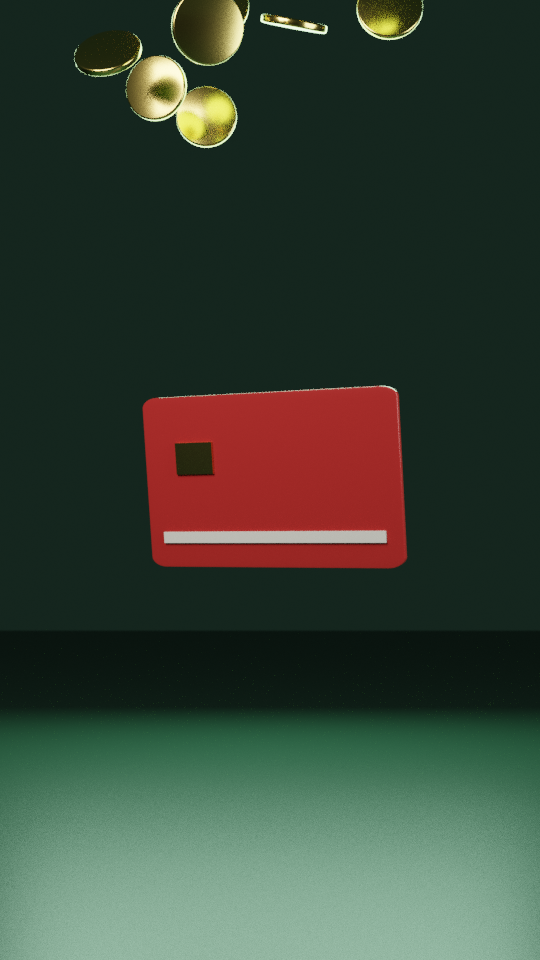

# Vídeos 3D com Blender

A fábrica escreve cenas 3D em Python para o Blender (gratuito) e renderiza com o Cycles, o mesmo motor de quem faz 3D profissional: luz física, reflexo de metal, sombra suave, profundidade de campo.

Teste (`blender/cena_cartao.py`): cartão girando e moedas de ouro caindo, renderizado aqui na nuvem só na CPU, 540×960, 64 amostras, sem denoiser. Levou ~33 s por quadro.

## Onde renderizar
| Lugar | Tempo por quadro (estimativa) | Vídeo de 30 s (900 quadros) |
|---|---|---|
| Nuvem do Claude (2 núcleos, sem placa de vídeo) | ~30 s em 540p | ~8 h: só para testes e quadros soltos |
| GitHub Actions (CPU) | parecido | estoura o limite de 6 h |
| **PC do Tiago (RTX 3060, OptiX + denoiser)** | alguns segundos em 1080p | algo como 30–90 min (a medir no primeiro teste) |

Por isso o 3D é para **trechos curtos e peças especiais** (abertura de 3–5 s, fundo em loop, capa), não para o vídeo inteiro. O resto continua no motor da fábrica (Remotion), que renderiza em minutos.

## Rodar no PC do Tiago
1. Instale o Blender oficial (blender.org, gratuito; versão 4.x).
2. Baixe o repositório (`git clone` ou Code → Download ZIP).
3. No terminal, dentro da pasta:
   `"C:\Program Files\Blender Foundation\Blender 4.2\blender.exe" -b -P blender/cena_cartao.py -- --gpu --res 1080 --amostras 64 --frames 1-90 --saida saida/blender/cartao_`
4. Os quadros saem em PNG; a fábrica junta em vídeo (`ffmpeg -framerate 30 -i saida/blender/cartao_%04d.png -c:v libx264 -pix_fmt yuv420p public/midias/cartao.mp4`) e usa como mídia ou fundo nos blocos.

## Regras
- Modelos 3D feitos por código pela fábrica ou de bibliotecas com licença livre (CC0, ex.: Poly Haven); nada de personagens ou marcas conhecidas.
- O 3D é vitrine; o conteúdo continua sendo dado original e roteiro do estúdio.
