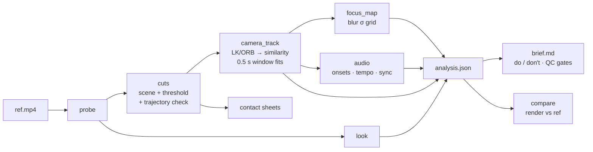

<p align="center">
  
</p>

<p align="center">
  <b>Reverse-engineer any reference video into measured camera language and a recreation brief.</b><br>
  An agent skill for Claude Code, Cursor and any agent that reads <code>SKILL.md</code>. Python + OpenCV + ffmpeg. MIT.
</p>

---

In the story, the Sharingan is the eye that sees a technique once and copies it. **video-sharingan** does that
for motion: show it a launch video, a changelog film or a trailer you love, and it tells you **exactly** how it
was shot. You get the cuts to the frame, every camera move in **px/s and %/s**, whether the lens ever stops,
where focus sits, how the grain and vignette look, and whether the cuts land on the beat. Then it writes a
brief that Hyperframes, `/brag`-style launch skills, Remotion or a human motion designer can follow, plus
the QC gates to prove your render matches.

Most tools *describe frames* ("a slow zoom on a dashboard"). video-sharingan **measures camera language**:

```text
shot 3 · 4.63 s · truck-right+push-in · 53.1 px/s (2.76 %W/s) · +1.21 %/s · ease linear · never stops ✓ · cut mid-move ✓
```

## What it measures

| | measured | how |
|---|---|---|
| **Edit** | cuts (frame-exact), shot durations, ASL, cuts/min | ffmpeg scene score + adaptive diff threshold, verified by **camera-trajectory continuity** (UI reflows aren't cuts) |
| **Camera** | move type (static · truck · pedestal · pan · tilt · push-in · pull-out · roll · orbit), speed in px/s, 1080p-equivalent px/s and %W/s, scale %/s, rotation °/s, easing curve (GSAP + CSS names), never-stops, enters/exits moving, pull-out windows, shake | LK or ORB features → RANSAC similarity per frame + direct 0.5 s window fits; homography keystone for perspective |
| **Framing** | macro / medium / wide | median height of sharp UI elements |
| **Focus** | deep / tilt-shift band / spot, band angle, rack focus, blur σ per cell, heatmaps | two-scale edge ratio → blur σ (content-independent) |
| **Look** | grain σ, vignette falloff, bloom, chromatic aberration, grade, letterbox | Immerkaer noise on flat pixels, median-frame radial profile, R/B phase correlation |
| **Pacing** | UI micro-animations (when the UI itself changes) vs camera speed | residual after motion compensation |
| **Audio** | music vs SFX, tempo, onsets, cuts on beat (vs chance), SFX synced to UI events | spectral-flux onsets refined in the time domain (~1 ms), autocorrelation tempo |

It **ignores theme on purpose**: dark mode, palette, fonts and branding are not the technique. Your product
keeps its own look; you copy the grammar.

## Quickstart

```bash
git clone https://github.com/nikolasfaria/video-sharingan && cd video-sharingan
pip install -r requirements.txt          # numpy + opencv-python-headless (needs ffmpeg on PATH)

./sharingan analyze reference.mp4 -o ref          # → ref/analysis.json, ref/brief.md, ref/sheets/*.png
./sharingan analyze my-render.mp4 -o render
./sharingan compare ref/analysis.json render/analysis.json   # gate table, exit 1 on failure
```

### As an agent skill

Put the folder where your agent looks for skills, e.g. `~/.claude/skills/video-sharingan` (Claude Code) or
`.cursor/skills/video-sharingan` in a Cursor project. Then ask:

> "Here's a launch video I love (ref.mp4). Make ours move like this."

The agent follows [`SKILL.md`](SKILL.md): probe → cuts → contact sheets → camera per shot → focus/look →
audio → brief → render → **compare** → fix one axis → repeat.

### Every stage runs alone

```bash
./sharingan probe ref.mp4
./sharingan cuts ref.mp4 -o shots.json [--cuts 3.5,7.25]        # or force cuts by hand
./sharingan sheet ref.mp4 --shots shots.json -d sheets/
./sharingan camera ref.mp4 --shots shots.json [--method orb]    # second, independent tracker
./sharingan focus ref.mp4 --shots shots.json --png-dir focus/
./sharingan look ref.mp4
./sharingan audio ref.mp4 --shots shots.json --camera camera.json
./sharingan brief ref/analysis.json --title "My reference"
```

## What you get

A `brief.md` in the format of [`templates/brief.md`](templates/brief.md). It opens with a paste-able
**distilled spec** (following the Hyperframes advice: absolute values, never relative nudges), then camera
rules, framing, optics, editing, audio, a shot table, **do/don't** rules, QC gates and a deviations log.
An excerpt from the synthetic test reel:

> **Distilled spec:** 20.0 s 1280x720 at 24.0 fps, 6 shots (2.75–3.75 s, mean 3.33 s) joined by hard cuts.
> Camera: 60.0–80.0 px/s of on-screen motion at 1080p, push-in 1.2–1.51 %/s, includes pull-outs. Optics:
> mostly deep focus; grain fine, vignette medium. Audio: music+sfx at 120.0 BPM.

| # | dur | move | speed px/s (1080p) | scale %/s | ease | never stops | DOF |
|---|---|---|---|---|---|---|---|
| 1 | 3.5 | truck-right | 60.0 | −0.0 | linear | yes | deep |
| 2 | 3.75 | push-in | 0.0 | 1.51 | linear | yes | shallow-band |
| 3 | 3.25 | pedestal-up | 74.9 | −0.0 | power1.inOut | no | deep |
| 4 | 3.25 | pull-out | 0.0 | −1.98 | linear | yes | deep |
| 5 | 2.75 | static | 0.0 | −0.0 | — | no | deep |
| 6 | 3.5 | truck-right+pedestal-up+push-in | 80.0 | 1.2 | linear | yes | deep |

```text
✅ Push-ins at 1.2–1.51 %/s of scale (absolute: 0.6–0.76 % per 0.5 s).
✅ Cut on the beat (60% of cuts within ±45.0 ms of a beat).
✅ Sync a short SFX (tick/click/type) to UI state changes (100% land within one frame).
❌ No handheld shake or camera noise: the move is mathematically smooth.
❌ Don't copy the reference's theme, palette or branding. Keep your own product's UI; copy the grammar.
```

For a real-world brief, see [`examples/linear-style-changelog/brief.md`](examples/linear-style-changelog/brief.md).
It is a Linear-style changelog reference reduced to numbers (mobile cut ≈ 21 px/s, desktop cut ≈ 53 px/s,
push-in +0.8 to +1.8 %/s, shots 2.4–7.7 s, constant speed, hard cuts mid-move), plus how two launch films rendered
from that brief measured against it.

## Proven against ground truth

`examples/synthetic/make_synthetic.py` renders a 20 s reel with a camera, edit and soundtrack known
exactly (sub-pixel affine warps, real H.264/AAC encode). `pytest tests/` analyzes it and checks **63 numbers**:

| | ground truth | measured |
|---|---|---|
| cut frames | 84, 174, 252, 330, 396 | 84, 174, 252, 330, 396 |
| truck speed | 40.0 px/s | 40.0 px/s |
| diagonal (vx, vy) | −50.0, +18.0 px/s | −50.2, +18.1 px/s |
| push-in | +1.511 %/s | +1.51 %/s |
| pull-out | −1.980 %/s | −1.981 %/s |
| eased pedestal | 160 px, power1.inOut | 160.2 px, power1.inOut |
| UI state changes | frames 30, 351, 369 | frames 30, 351, 369 |
| tempo / cuts on beat | 120 BPM / T F T F T | 120.1 BPM / T F T F T |
| SFX on UI events | 0 ms | 0.0–0.9 ms |

Full table: [`examples/synthetic/results.md`](examples/synthetic/results.md). The tracker was also checked on real
renders against an independent ORB tracker (speeds agree within ~1 px/s), and the cut detector on three real
launch films with large UI reflows (every cut frame-exact, 0 false cuts).

## Plug it into your generator

- **Hyperframes / `/brag`-style launch skills:** paste the distilled spec and sections 2–10 of `brief.md`
  into the composition prompt. "Linear camera" means GSAP `ease: "none"`. A push-in of +1.2 %/s is
  `scale: 1 → 1.012^duration`. Then run `sharingan compare` on the render. This is the "iterate with absolute
  targets, then distil the constants" loop from Hyperframes' *Recreating references* guide, with a tool that
  produces the absolute targets.
- **Remotion:**
  ```ts
  const t = frame / fps;                                    // seconds into the shot
  const x = interpolate(frame, [0, dur * fps], [0, vx * dur], {easing: Easing.linear}); // content layer moves at the measured content velocity
  const scale = Math.pow(1 + pushPctPerS / 100, t);         // measured %/s, compounding
  ```
- **After Effects / Motion / Resolve:** the shot table is your EDL. Speeds are in comp pixels at 1080p.

## How it works



Hard-won details are in [`references/camera-language.md`](references/camera-language.md): sign conventions,
how truck differs from pan, why per-frame scale fits lie, and how UI reflows fake both cuts and pull-outs.

## Limitations

- Dissolves and whip pans are not auto-classified (they show up on the contact sheet).
- Truck vs pan (and pedestal vs tilt) only separate when perspective visibly changes (> ~3°/s). On a
  flat screen recording they're the same 2D move.
- Look metrics (grain, vignette, bloom, CA) are heuristics. Heavy compression eats grain, and dark UI edges can
  imitate a vignette.
- Music/SFX classification is heuristic. Listen once.
- Textureless or extremely blurred shots may come back `untracked`. Set cuts by hand or crop to the subject.

## Repo layout

```
SKILL.md                      the agent recipe
sharingan                     CLI wrapper → scripts/sharingan.py
scripts/                      probe · cuts · contact_sheet · camera_track · focus_map · look · audio · brief · compare
templates/brief.md            recreation brief format
references/camera-language.md conventions, thresholds, production traps
examples/synthetic/           ground-truth reel generator, checker, measured outputs
examples/linear-style-changelog/brief.md   worked real-world example (numbers only, no media)
tests/                        pytest end-to-end + unit tests
assets/                       banner + logo (original SVG)
```

## Credits

- **[scriptscrypt/animation-reverse-engineering](https://github.com/scriptscrypt/animation-reverse-engineering)**
  introduced the measured frame-by-frame method for UI animation: probe first, contact sheets, crop-band stacks,
  easing read from per-frame deltas, and a deviation log. video-sharingan takes that "dissect, don't eyeball"
  method to the **camera**, then automates and validates it.
- **[HeyGen Hyperframes: Recreating something you saw](https://github.com/heygen-com/hyperframes/blob/main/docs/prompting/recreating-references.mdx)**:
  transcribe motion rather than composition, iterate with absolute targets, and distil converged constants into a
  one-shot spec. Our brief format and `compare` loop follow it.
- Built on [OpenCV](https://opencv.org/), [NumPy](https://numpy.org/) and [FFmpeg](https://ffmpeg.org/).

The eye artwork is an original SVG made from a traditional *tomoe* motif. It's a fan nod, not affiliated with
any franchise. Please use this tool to study **technique**. Don't ship 1:1 clones of someone else's brand.

---

## 🇧🇷 Em português

**video-sharingan** é uma skill de agente que faz engenharia reversa da produção audiovisual de um vídeo de
referência (lançamento de feature, changelog, promo de app) e entrega **números**: cortes no frame exato,
duração de cada plano, tipo de movimento de câmera (truck, pedestal, pan, push-in, pull-out, órbita),
velocidade em **px/s** e **% da largura/s**, escala em **%/s**, easing, se a câmera **nunca para**,
enquadramento (macro/médio/aberto), foco e profundidade de campo, grão, vinheta, bloom, aberração cromática,
ritmo da UI vs. câmera e áudio (música vs. SFX, BPM, corte no beat). Ela ignora de propósito o tema
(dark mode, paleta, marca). O que se copia é a linguagem, não o visual.

A saída é um `brief.md` pronto para Hyperframes, skills tipo `/brag`, Remotion ou um motion designer, com
regras de faça/não faça e *gates* de QC. Depois de renderizar, rode
`./sharingan compare ref/analysis.json render/analysis.json` para provar que o seu vídeo bate com a referência.

```bash
pip install -r requirements.txt
./sharingan analyze referencia.mp4 -o ref
```

Tudo é validado contra um vídeo sintético com *ground truth* conhecido (63 checagens, todas passando) e foi
testado em produção em filmes reais de lançamento.

## License

[MIT](LICENSE) © 2026 Nikolas Faria
